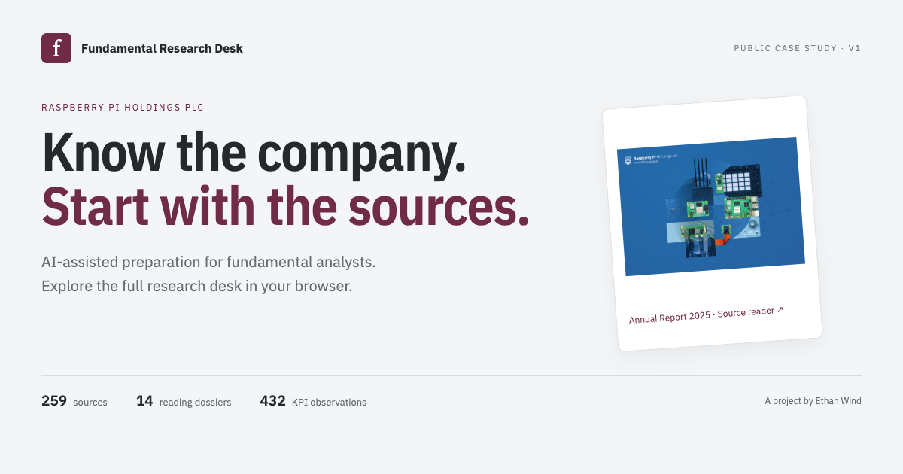

# Fundamental Research Desk

**AI-assisted preparation for fundamental analysts.**

[Open the Raspberry Pi case study](https://ethancwind-design.github.io/fundamental-research-desk/)



Public V1.0 is a complete, browsable example of a research-preparation workflow, built by Ethan Wind using Astra. It brings the company’s source material, reading paths, and human research preparation into one workspace.

## Explore the desk

- **Reading agenda:** 14 dossiers, 107 located reading assignments, and 110 questions.
- **Company timeline:** curated milestones alongside collected filing publications.
- **Source library:** 259 source records, including 180 hosted primary-source files and publisher references.
- **Document reader:** 45 PDFs / 3,083 physical pages, with page navigation, text selection, search, and deep links.
- **Reported KPIs:** 432 observations with source locations and metric definitions.
- **Research preparation:** 12 conversation/visit packets, three Pennsylvania sessions, ten field experiments, and a terminal checklist.
- **Personal workspace:** reading progress, a question queue, evidence notes, and optional import/export.

The source cutoff is **5 September 2026**. This is a fixed example, not a live feed or an on-demand company generator. The reader’s analysis, valuation, and investment judgment remain theirs.

## Source boundaries

Hosted source files include public primary-source PDFs, inert issuer/Foundation articles and regulatory announcements, and two official reporting ZIP archives. Article reading copies preserve source attribution and link to publisher originals; they do not execute publisher scripts. Third-party transcript references link to their publishers. No complete financial-call transcript is certified, and third-party transcript bodies are not republished here.

The source and coverage view records collection limits. Source counts describe this collection rather than all material ever published. Native extraction and OCR support navigation; verify wording, numbers, and tables in the original documents.

## Notes and privacy

No account is required. Personal notes and reading progress are stored only in the current browser. They are not uploaded or shared with other readers. Export notes to retain a backup or transfer them to another browser. Publisher links leave this site and are subject to the destination’s practices.

## About the workflow

This repository contains the **public example website and its prepared research output**. It does not contain the generation prompt, private working files, or company-generation workflow. Those are shared separately by Ethan Wind on request; readers arriving from LinkedIn can contact him by DM there.

## Website maintenance

The site is static HTML, CSS, and JavaScript. There are no model API keys, external AI calls, or database credentials. GitHub Pages deploys the main branch through the included workflow. Local preview:

```sh
python3 -m http.server 4173
```

Open `http://localhost:4173`. A web server is needed for PDF rendering and the on-demand search index. The large searchable corpus loads only when source-text search or the coverage audit is opened.

## Credits

Created by Ethan Wind. Independent project; not affiliated with Raspberry Pi. Research preparation only; no investment recommendation.

Source documents retain their publishers’ attribution and applicable rights. The public data records identify originals. PDF.js is bundled under its Apache 2.0 license; font licenses are included with the assets. See [NOTICE.md](NOTICE.md).
